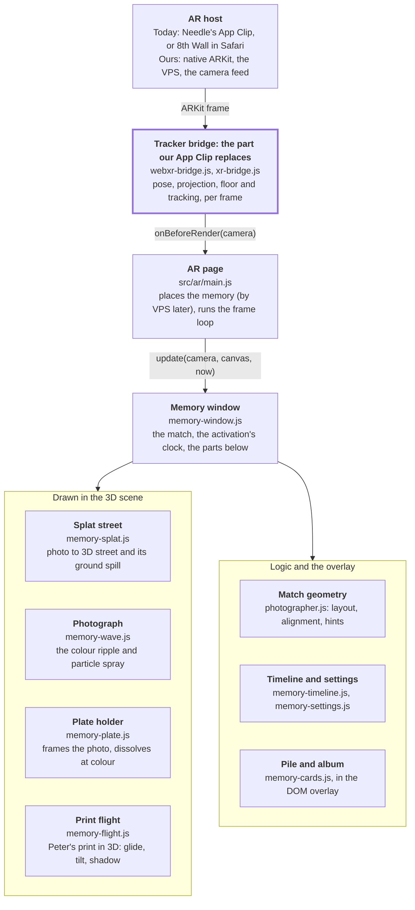

# Apalabassa St. memory: App Clip handoff

The Apalabassa St. memory is ready to bring into our App Clip. A viewer stands where the photographer stood in old Chinatown and lines the historical photograph up on their phone. Peter SooHoo's print glides into it, and the photograph turns to colour and opens into the restored street in 3D. Today it runs as a web page (three.js with Spark Gaussian splats) inside Needle's App Clip; this README is what you need to bring it into ours.

To run it locally: `npm install`, put the three splat files in `public/` (see [Assets](#assets-and-how-to-rebuild-them)), then `npm run dev` and open `/memory.html?controls=1` for the desktop preview or `/ar.html` on a phone.

## What the viewer experiences

From the moment the match locks to the open street takes about 11 s. The viewer only taps once, to place it; everything after is standing, turning and holding still.

1. **Place.** A tap places the memory relative to the phone. An old wooden plate holder holding the black-and-white photograph (0.49 × 0.37 m) floats 1.8 m ahead at 1.55 m above the floor.
2. **Turn sideways.** A viewfinder frame appears, fixed on the screen, with a one-line hint naming what to fix. A pile of eight photographs of people who lived there deals into the bottom-right corner; tapping it opens an album (a grid, and each print's story beside it when tapped).
3. **Match.** The viewer walks 1 m up to the photographer's spot and lines the photograph up in the frame: corners within 4°, phone level. Holding that for 0.6 s eases the memory onto the phone so the cut lands exactly.
4. **Peter arrives (2.8 s).** The rest of the pile steps aside (0.36 s). Peter SooHoo's print then leaves the corner as a 3D card and glides into the photograph on one tilted curve (2.4 s), its shadow gathering on the photograph. Its touch starts the colour.
5. **Colour (4.2 s).** Colour ripples out from where he stands and the print dissolves into the man in the street. From 3.4 s the plate holder dissolves outward, with a thin cream edge.
6. **Hold (0.8 s).** The restored photograph stays flat while the last of the holder goes.
7. **Open (3.1 s).** The window grows into a 4.1 × 3.1 m portal standing on the floor 3.4 m ahead. The street opens into 3D with a slight dolly zoom, and its ground spills through the portal like daylight through a doorway.

## Where everything is

`main` is the portal experience; the previous `main` is kept on an archive branch.

| What | Where |
| --- | --- |
| Code | This repository, branch `main` |
| Previous `main` | `archive/main-2026-11-12` at `ebf8936` (native iOS and WebAR band effects) |
| Earlier versions | `claude/photographer-match-cut` (the match), `claude/soohoo-cards` (Peter and the card deck); `claude/soohoo-plate` is this version |
| AR page | [`ar.html`](ar.html) → [`src/ar/main.js`](src/ar/main.js) |
| Desktop preview | [`memory.html`](memory.html) → [`src/memory-preview.js`](src/memory-preview.js) |
| Live test site | [chinatown-splat-plate.vercel.app](https://chinatown-splat-plate.vercel.app) (opens the AR page) |
| iPhone test today | [Needle App Clip link](https://appclip.needle.tools/ar?url=https%3A%2F%2Fchinatown-splat-plate.vercel.app%2F) |
| Technical notes | [`docs/WEBAR.md`](docs/WEBAR.md): the match geometry, timeline, splat mapping and spill in depth |
| VPS research | [Union Station VPS Options](https://claude.ai/artifact/DvXtraAcntkjyn16oZHvei) (private; ask the repo owner for access) |

## How it is built

Our App Clip only has to replace the tracker bridge. The page draws over the camera, and one memory window drives every part of the experience from a single call per frame.



Every file is in `src/`. The table says what each one does, and what it would take if we ever port to native (path B below).

| File | What it does | If ported to native |
| --- | --- | --- |
| [`ar/main.js`](src/ar/main.js) | The AR page: chooses the tracker, places the memory, runs the frame loop, Reset and the Tune dock | Becomes the App Clip's own code |
| [`ar/webxr-bridge.js`](src/ar/webxr-bridge.js), [`ar/xr-bridge.js`](src/ar/xr-bridge.js) | Hand the camera, projection, floor and tracking to the page | Replaced by our bridge (path A) |
| [`memory-window.js`](src/memory-window.js) | Builds the stage; runs the match, the arrival and the activation; owns the photograph's shader | A rewrite, but small |
| [`photographer.js`](src/photographer.js) | Derives the layout from the settings and the screen; screen-space alignment and hints | Ports as is: pure math |
| [`memory-timeline.js`](src/memory-timeline.js), [`memory-settings.js`](src/memory-settings.js) | The activation's clock and stages; every setting with its range | Ports as is |
| [`memory-splat.js`](src/memory-splat.js), [`memory-wave.js`](src/memory-wave.js) | Moves each splat from the flat photograph to its place in the street; the ripple every layer shares | The hardest part: per-splat deformation on the GPU |
| [`memory-plate.js`](src/memory-plate.js) | The plate holder: fitted to the photograph, lit by its own shader, dissolving | Load the same model; port the shader |
| [`memory-flight.js`](src/memory-flight.js) | Peter's print in 3D: starts at the 2D print's exact screen pose, glides, tilts, casts its shadow | The path math ports as is; the shaders are rewritten |
| [`memory-cards.js`](src/memory-cards.js), [`memory-cards.css`](src/memory-cards.css), [`memory-people.js`](src/memory-people.js) | The pile and the album in the overlay; the people, their photographs and text | SwiftUI |
| [`memory-props.js`](src/memory-props.js) | Loads the plate holder and Peter's print for the page and the preview | Asset loading |
| [`ar/tuning.js`](src/ar/tuning.js) | The Tune dock | Optional |

## Bringing it into our App Clip

Host this web build inside our App Clip and feed it from native ARKit, as decided in October: it reuses everything tuned here, and the experience keeps shipping through Vercel without an App Store review per change. Port it to native only if the web view cannot hold frame rate or stay in sync with the camera on our target iPhones.

| | A: host the web build (recommended) | B: port to native |
| --- | --- | --- |
| What we build | An App Clip that runs ARKit (and later the VPS) natively, draws the camera feed, and shows the page in a transparent web view on top, fed pose, projection, floor and tracking each frame | The whole experience in Swift and Metal |
| What carries over | All of it: the page already runs behind two trackers through small bridges (WebXR in `src/ar/webxr-bridge.js`, 8th Wall in `src/ar/xr-bridge.js`); ours is a third | The pure math ports directly (`src/photographer.js`, `src/memory-timeline.js`, the flight path in `src/memory-flight.js`); the shaders and the splat deformation are rewritten |
| Hardest part | Keeping the web view's pose in step with the camera image, frame by frame | The splat modifier (`src/memory-splat.js`): per-splat deformation of centres and covariances on the GPU. RealityKit draws no Gaussian splats; [`ios/`](ios) in the repo has an ARKit plus MetalSplatter experiment to start from |
| VPS | Native, passed to the page as the anchor's pose | Native |
| Starting points | [`ios/`](ios) (ARKit, camera feed in Metal) with a small bridge; HoloWeb's frame-sync approach (realitydeslab/holoweb-app, MIT, iOS 27 only) | [`ios/`](ios) |
| Size | The binary stays small; the 6.4 MB of splats and the photographs load over the network | Assets inside the binary or downloaded |

Today, Needle's App Clip plays the WebXR role: it runs ARKit and gives the page a WebXR `immersive-ar` session. It is closed, so it cannot carry our VPS. That is the gap our App Clip fills.

## What the host must provide

The page needs a camera pose and projection every frame, the floor, a tap layer on top, and to know when tracking is unsure. A WebXR host gives all of it through one `immersive-ar` session with the optional features `local-floor`, `hit-test` and `dom-overlay`. A custom bridge supplies the same values directly.

| Need | Why | Where in the code |
| --- | --- | --- |
| Camera pose and projection, every frame, in step with the camera image | Everything is placed and matched from them; the guide frame is fixed to the camera | `onBeforeRender(camera)` in `src/ar/main.js`; `src/ar/webxr-bridge.js` |
| A projection that fills the canvas, with square pixels | The matched photograph's size follows the phone's field of view, measured at placement | `screenTangents()` in `src/photographer.js` |
| Floor height | The memory and the street stand on it. `local-floor` gives y = 0; otherwise the page hit-tests straight down, then assumes 1.45 m below the start | `floorHeight()` in `src/ar/webxr-session.js` |
| Tracking state: normal or limited | The match pauses while tracking is unsure, so a jumping pose can't fake it | `onTracking` → `memory.setMatching()` |
| An overlay above the camera that takes taps, as the session's DOM overlay | The hint, the pile, the album and the buttons live in `#ar-ui` | `ar.html`, `src/ar/main.js` |
| `beforexrselect` honoured on the overlay | Taps on the pile or album must not also become AR taps | `src/memory-cards.js` |
| Taps on the view | A tap places the memory | `onTap` in `src/ar/main.js` |
| Portrait page (rotation lock is fine) | The page does not rotate; the UI turns itself by the phone's roll | `uprightTurn()` in `src/photographer.js` |
| WebGL2 | Spark's splat renderer and the shaders | `src/splat-scene.js` |
| HTTPS and camera permission | The page, about 7 MB of splats and photographs at the default budget | `scripts/prepare_vercel.mjs` |

## Placing it at the site and driving it

Placement is the one seam the VPS replaces: today a tap places the memory relative to the phone; at Union Station the VPS pose places it. Everything after is one call per frame.

**Today, on a tap** (`place()` in `src/ar/main.js`):

```js
const pose = anchorPoseFromCamera(camera);             // the phone's position, its heading kept level
anchor.position.copy(pose.position);
anchor.quaternion.copy(pose.quaternion);
memory.setScreen(screenTangents(camera.projectionMatrix.elements));
memory.setFloor(tracker.groundY() - pose.position.y);  // the floor, in the anchor's frame
memory.reset();
anchor.visible = true;
await memory.prime(renderContext);                    // maps the splats for this pose before the first frame
```

**With the VPS**, set the anchor from the site instead of the phone. The anchor is the placement point, looking down its −z and kept level. The photographer's spot is `walkDistance` (1 m) ahead of it at `matchHeight` (1.55 m) above the floor, and the photograph 0.8 m beyond. So put the anchor 1 m behind the surveyed spot, turned the way the photographer faced, then run the same lines from `setScreen` on.

**Every frame**, before rendering:

```js
const frame = memory.update(camera, canvas, performance.now() / 1000);
if (anchor.visible && frame.phase !== "dormant") updateEffects(memory.effectsCamera(camera), seconds, frame.effects);
```

| Call | When |
| --- | --- |
| `createMemoryWindow({ anchor, splat, matte, config, hint, cards, flight, plate, settings, onPhase })` | Once, after the splats load; `...await loadMemoryProps(PEOPLE)` supplies `plate` and `flight` |
| `prepare(context)` | Once the renderer exists, before Start: compiles every shader and warms the splats, so nothing stalls later |
| `prime(context)` | After every placement |
| `update(camera, canvas, now)` | Every frame |
| `setMatching(enabled)` | Whenever tracking changes |
| `reset()` | On Reset, or when the AR session ends |
| `activate(now)` | Starts the activation without the match (the tuning dock's Replay) |
| `onPhase(phase)` | Reports `dormant`, `colorizing`, `surface`, `expanding`, then `active` |

## Settings

The defaults below were tuned on a phone; they live in [`src/memory-settings.js`](src/memory-settings.js). Any of them can be overridden by URL (`?matchHeight=1.6&dolly=0.3`) or live with the AR page's Tune button, whose Copy link captures the result. The layout of the photograph, portal and street is derived from these values, never set directly (`photographerLayout()` in [`src/photographer.js`](src/photographer.js)).

| Setting | Default | What it does |
| --- | --- | --- |
| `matchHeight` | 1.55 m | Height of the photograph's centre, and of the phone at the match |
| `walkDistance` | 1 m | From the placement point to the photographer's spot |
| `photoDistance` | 0.8 m | From the spot to the photograph |
| `matchFrame` | 0.8 | Share of the sideways screen's height the matched photograph fills |
| `matchTolerance` | 4° | How close the corners and the phone's level must be |
| `matchHold` | 0.6 s | How long the match must hold |
| `dolly` | 0.3 | Dolly zoom as the window opens; 0 is the photographer's exact view |
| `sceneScale` | 1.04 | Size of the street against the reconstruction, which is about metric |
| `colorDuration` | 4.2 s | Black and white to colour |
| `flatHoldDuration` | 0.8 s | The colour photograph holding flat while the plate holder dissolves |
| `depthDuration` | 3.1 s | The street opening into 3D |
| `spillStrength`, `spillAngle`, `spillSoftness` | 6.3, 31°, 60° | The street's ground spilling through the portal like daylight |

For debugging, the AR page also takes `?splats=full|50|25` (splat budget, 50 by default), `?tracking=webxr|xr8`, `?fx=none`, `?dpr=` and `?debug=1` (a status readout).

## Assets and how to rebuild them

Everything is in the repo except the splats, which are Git-ignored: ask the repo owner for them, or rebuild them. Vite bundles the photographs and the plate with hashed names; `npm run vercel:prepare` refuses to build without all three splat files.

| Asset | Where | Size | Notes |
| --- | --- | --- | --- |
| The street as Gaussian splats, three budgets | `public/apalabassa-soohoo.sog`, `_50.sog`, `_25.sog` | 11.3, 6.4, 3.3 MB | Not in Git. 50% is the default |
| Historical photograph | [`input/apalabassa-original.jpg`](input/apalabassa-original.jpg) | 2000 × 1557, 0.5 MB | The black-and-white original, unmodified |
| Restored colour photograph, with Peter in the street | [`input/apalabassa-soohoo.webp`](input/apalabassa-soohoo.webp) | 1448 × 1086, 0.43 MB | Source of the reconstruction and of the colour |
| Plate holder | [`input/plate/photo-plate.glb`](input/plate/photo-plate.glb) | 279 KB | The holder only, cut from a Tripo model |
| People's photographs | [`input/people/`](input/people) originals; `cards/` 400 px copies; `prints/` 1200 px copies | 244 KB cards, 932 KB prints | Titles, placeholder text and Peter's eye positions in [`src/memory-people.js`](src/memory-people.js) |
| 8th Wall engine | `public/external/xr/` | 30 MB | Copied from `@8thwall/engine-binary` by `npm run xr:copy`; loaded only where WebXR is missing; closed source, limited licence |

To rebuild the street (Python with numpy, scipy and Pillow, plus Apple's SHARP):

1. Convert `input/apalabassa-soohoo.webp` to PNG at `output/sharp-input/apalabassa-soohoo.png`.
2. `sharp predict -i output/sharp-input/apalabassa-soohoo.png -o output/apalabassa-soohoo --device mps`
3. PlayCanvas `splat-transform` with `-d 50%` and `-d 25%`, then each PLY to `public/apalabassa-soohoo{,_50,_25}.sog`.
4. `python scripts/fit_ground.py output/apalabassa-soohoo/apalabassa-soohoo.ply`, and copy its ground values into `captureGroundUp`, `captureCameraHeight` and `captureGroundStart`.
5. `python scripts/register_original.py input/apalabassa-original.jpg input/apalabassa-soohoo.webp`, and copy the result into `originalFrame`.

To rebuild the plate holder from a model: `python -I scripts/extract_plate.py <model>.glb input/plate/photo-plate.glb`.

## Testing

Unit tests cover the geometry and the timing; the motion and the look are checked in the desktop preview, then on a phone.

1. `npm test` runs 43 node tests. They cover the match geometry and hints, the lock and the activation, and the 3D print's handoff, landing, tilt and shadow. They also cover the plate holder and the match waiting while the album is open.
2. `npm run dev`, then `/memory.html?controls=1`: the same controller seen through a sideways phone, with Walk forward to reach the spot, a timeline to scrub, and Replay. `/ar.html?xremu=1` runs the WebXR path in a desktop browser with an emulated device (development builds only).
3. On a phone: `npm run vercel:prepare`, then deploy the prebuilt output to that version's own Vercel project (`VERCEL_ORG_ID=… VERCEL_PROJECT_ID=… vercel deploy --prebuilt --prod`). Preview deployments sit behind Vercel's login, which an App Clip cannot pass. Open the site through the App Clip link.

Each version has its own site: `chinatown-splat-plate` is this one; `-soohoo`, `-match-dolly` and `-match-cut` are earlier, and `chinatown-splat-ar` is the original production. No Vercel project is connected to the repo, so pushing to `main` deploys nothing; a site changes only with an explicit deploy.

## Open items before launch

This version was checked in the desktop preview and the WebXR emulator, but not yet on a phone.

- [ ] Play this version on an iPhone: the plate holder, the album, the 3D glide and the 1.55 m matching height.
- [ ] Build our App Clip's bridge: pose, projection, floor and tracking in step with the camera image.
- [ ] Place by VPS at Union Station instead of by tap; confirm the photographer's surveyed spot and heading.
- [ ] Confirm taps on the pile and album never also place the memory in our host (`beforexrselect`).
- [ ] Check the pile clears the Dynamic Island and home indicator on real phones; safe areas were only simulated.
- [ ] Replace the album's placeholder text, and confirm the photographs' titles and credits.
- [ ] Clear rights for the photographs, the restoration and the plate holder model (made with Tripo).
- [ ] Measure frame rate and GPU memory on our oldest target iPhone. Covariance splats are heavier than packed ones, and the plate's texture takes about 21 MB.
- [ ] Decide whether to keep 8th Wall as the Safari fallback without the App Clip (closed engine, limited licence).
